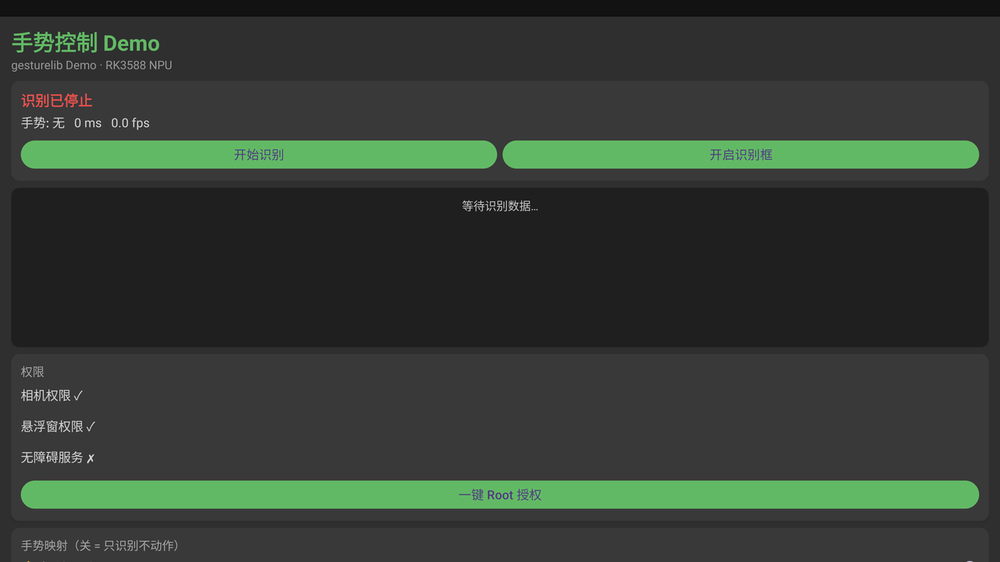
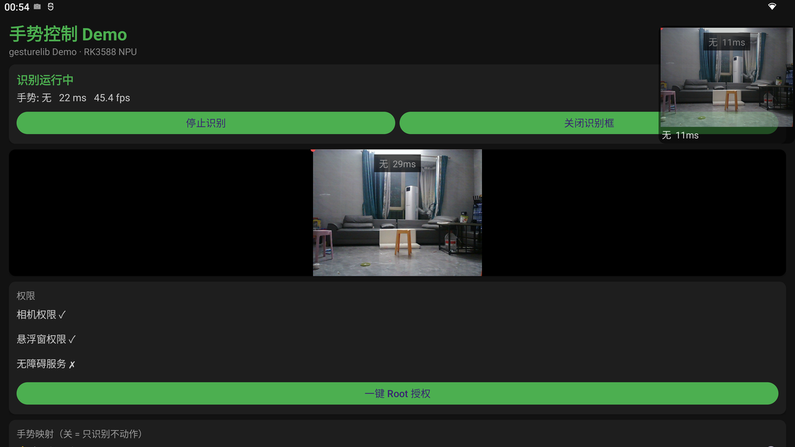

<div align="center">

# rk3588-air-gesture

**RK3588 NPU 隔空手势控制 · Android AAR 库 + Demo**

使用 RK3588 的 6 TOPS NPU 实时识别摄像头手势：
🖐 4 方向滑动 · 👋 挥手 · ✊ 确定 · ✌️ 返回

[English](README_en.md) | 中文

`非商业授权 · 个人免费使用`

</div>

---

## ✨ 功能特性

- **NPU 实时推理**：MediaPipe 手部模型（掌检测 + 21 关键点）转 RKNN fp16，
  单帧 30~40ms，悬浮识别框实时显示骨架
- **精选手势集**：✋ 张掌挥动 = 上/下/左/右滑动 · 👋 挥动手臂 · ✊ 拳头 = 确定 · ✌️ 剪刀手 = 返回
- **滑动/挥手自动区分**：单次大幅位移后停住 = 方向滑动；左右往复摆动 = 挥手，互不误触
- **封装为 AAR 库**：五类 API（悬浮识别框 / 启停识别 / 实时回调 / 动作映射 / 算法帧输入），
  一行代码集成到任何 App
- **算法帧输入**：不接相机也能用 —— 一张 `Bitmap` 图片或外部 YUV 帧直接送 NPU，
  推理结果通过回调返回（手势 / 置信度 / 21 关键点 / 掌框 / 耗时），
  连续帧模式复用完整时序状态机
- **可配置**：每个手势可单独设为「只识别不动作」或重映射；全局动作间隔防误触
- **root 增强**：按键注入（确定/返回）、无障碍/权限自动授权、开机自启

## 📖 图文使用教程

### 第 1 步 · 安装与授权

从 [Releases](https://github.com/295173098/rk3588-air-gesture/releases) 下载 `app-debug.apk` 安装：

```bash
adb install -r app-debug.apk
```

打开 App，点「**一键 Root 授权**」，相机 / 悬浮窗 / 无障碍三项全部变 ✓：



### 第 2 步 · 开始识别

点「**开始识别**」—— 悬浮服务启动，NPU 管线运行（可在 logcat 看到
`GestureNPU: init OK`）。底部预览出现实时画面与骨架。

### 第 3 步 · 悬浮识别框（可选）

点「**开启识别框**」—— 右上角出现独立悬浮窗：实时预览 + 手势徽标 +
置信度显示，悬浮于**任何** App 之上，方便随时看到识别状态：



### 第 4 步 · 对着摄像头做手势

距镜头 40~60cm，掌心正对镜头。默认手势表：

| 手势 | 功能 | 说明 |
|------|------|------|
| ✋ 张掌向上挥 | 向上滑动 | 位移超阈值 + 停住即触发 |
| ✋ 张掌向下挥 | 向下滑动 | 刷视频、滚动列表 |
| ✋ 张掌向左挥 | 向左滑动 | 左右翻页 |
| ✋ 张掌向右挥 | 向右滑动 | |
| 👋 左右往复摆动 | 挥手事件 | 只回调不动作，`setAction` 可重映射 |
| ✊ 拳头 | 确定 | 焦点 OK 键（需 root） |
| ✌️ 剪刀手 | 返回 | 无障碍 globalBack / root 兜底 |

> 滑动与挥手互不干扰：持续摆动永远不会误触方向滑动；
> 手势映射可在 App 内逐项开关（关 = 只识别不动作），
> 库集成方可用 `setAction` / `setActionHandler` 任意重映射。

### 第 5 步 · 作为库集成（可选）

把 `gesturelib-release.aar`（见 Releases）放进你的工程：

```kotlin
dependencies { implementation(files("libs/gesturelib-release.aar")) }

GestureEngine.init(context)
GestureEngine.startRecognition()
GestureEngine.showOverlay(true)
GestureEngine.setOnGestureListener(object : GestureListener { /* 实时回调 */ })
GestureEngine.setAction(GestureId.WAVE, null)          // 只识别不动作
GestureEngine.setAction(GestureId.FIST, GestureAction.BACK)  // 重映射动作
```

完整 API 见 [INTEGRATION 文档](gesturelib/README_API.md) 或 demo 源码 `app/`。

### 第 6 步 · 算法帧输入（图片 / 外部帧 → NPU → 回调）

除了相机，也可以把**外部帧**直接送入同一套 NPU 管线。Demo 主界面新增
「算法帧输入」卡片：选一张图片即可看到识别结果。

```kotlin
GestureEngine.init(context)

// 单帧: 图片 → NPU → 回调 (异步, 回调在后台线程)
GestureEngine.analyzeImage(bitmap) { r ->
    if (r != null && r.hasHand) {
        Log.i("Demo", "${r.gestureName} score=${r.score} ${r.inferenceMs}ms")
        val landmarks = r.landmarks      // 21×3, 图像归一化坐标
    }
}

// 同步版 (勿在主线程调用)
val result: FrameDetection? = GestureEngine.analyzeImage(bitmap)

// 连续外部帧 (视频流 / 其他相机 / 算法前处理结果): 与相机识别互斥
GestureEngine.startFrameInput()
GestureEngine.pushFrame(bitmap)      // 每帧调用; 上一帧未处理完时自动丢帧
GestureEngine.pushYuvFrame(y, u, v, width, height,
    yStride, uStride, vStride, uPixelStride, vPixelStride)
GestureEngine.stopFrameInput()
```

回调结果 `FrameDetection`：

| 字段 | 说明 |
|------|------|
| `hasHand` | 本帧是否检测到手 |
| `gesture` / `gestureName` | 静态手势 id / 名称 |
| `score` | landmark 置信度 0..1 |
| `openFingers` | 伸直手指数 0..5 |
| `palmX/Y/W/H` | 掌心框（图像归一化） |
| `landmarks` | 21×3 关键点（x,y,z 归一化） |
| `inferenceMs` | 单帧 NPU 耗时 |

> 连续帧模式复用完整时序状态机：`onFrame` / `onGestureTriggered` 照常回调，
> 动作映射同样生效，只是帧来源从相机换成调用方。
> 外部帧模式不打开相机、不需要相机权限；调用 `startRecognition()` 会自动退出该模式。
> 输入帧尺寸不限（内部 letterbox），坐标按输入帧宽高归一化。

## 🔨 自行构建

```bash
git clone https://github.com/295173098/rk3588-air-gesture.git
cd rk3588-air-gesture
./gradlew :app:assembleDebug          # Demo APK
./gradlew :gesturelib:assembleRelease # 库 AAR
```

依赖：JDK 17 · Android SDK 34 · NDK 26.3 · CMake 3.22.1（模型转换见 `tools/model_convert/`）

## 🧠 技术原理

```
相机 YUV420_888 / Bitmap 图片 / 外部 YUV 帧 → JNI: →RGB → letterbox 192
  → palm_detection.rknn (NPU) → 2016 anchors 解码 + NMS
  → 旋转 ROI → hand_landmark.rknn (NPU 224×224) → 21 关键点
  → 几何分类静态姿势 (张掌/拳头/剪刀手) + 掌心轨迹
  → 时序状态机 (确认帧/冷却/停止确认/折返计数)
      ├─ 方向滑动: 位移超阈值 + 停止确认, 主轴判定 → 无障碍注入 4 方向滑动
      ├─ 挥手: X 轴往复摆动 (折返 ≥2 次) → 事件回调
      ├─ 拳头确定: root input keyevent 23 (DPAD_CENTER)
      └─ 剪刀手返回: 无障碍 globalBack / root keyevent 4
```

相机帧与算法帧共用同一套 RGB 推理核心（JNI 内串行化），
单张图片分析会重置跟踪 ROI 并强制重新做掌检测。

解码数学严格对齐 MediaPipe 官方源码（SSD anchors / box decode / ROI 变换）。

## 📁 目录结构

```
gesturelib/   库模块（可单独发布 AAR）
app/          Demo App
tools/        模型转换脚本 (rknn-toolkit2)
docs/images/  教程配图
```

## 📄 许可证

本项目采用 [非商业授权 · 个人免费使用协议](LICENSE)：
个人学习、研究、爱好者使用**免费**；任何商业用途需事先取得作者书面授权。

## 🙏 致谢

[MediaPipe Hands](https://github.com/google-ai-edge/mediapipe) ·
[airockchip rknn-toolkit2](https://github.com/airockchip/rknn-toolkit2) ·
[PINTO0309 相关研究](https://github.com/PINTO0309)
