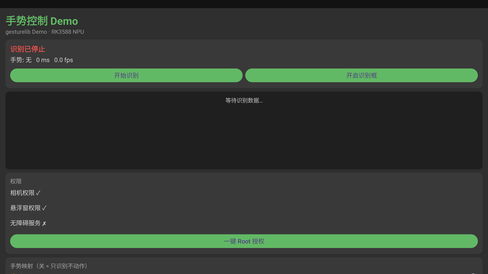
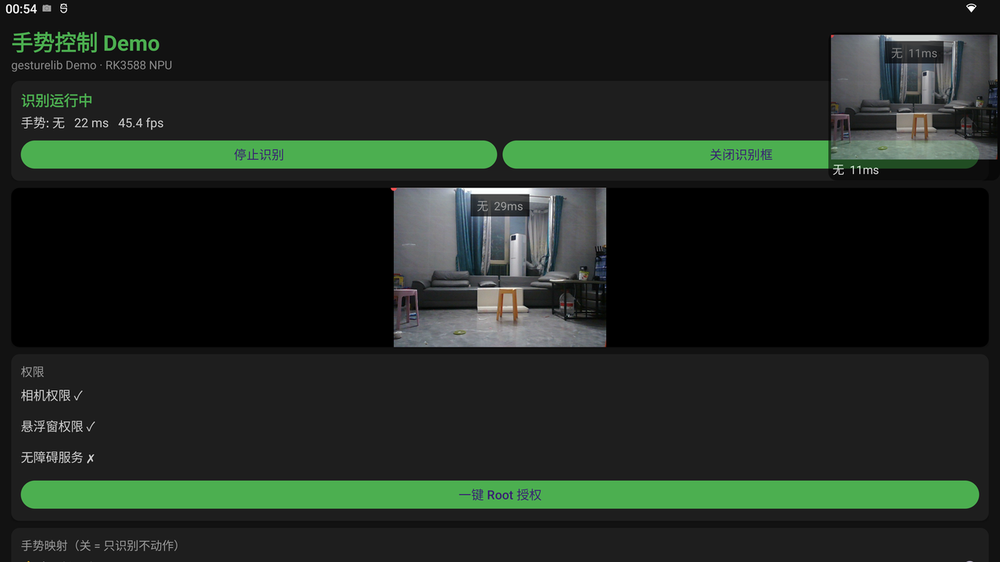

<div align="center">

# rk3588-air-gesture

**RK3588 NPU Air-Gesture Control · Android AAR Library + Demo**

Real-time camera gesture recognition on the RK3588 6-TOPS NPU:
🖱 virtual mouse (cursor / left / right / wheel) · 🔊 volume · 📃 swipe · ⬅️ back · 📸 screenshot

中文 | [English](README_en.md)

`Non-commercial license · Free for personal use`

</div>

---

## ✨ Features

- **Real-time NPU inference**: MediaPipe-style hand models (palm detection + 21
  landmarks) converted to RKNN fp16 — 30~40 ms per frame, live skeleton overlay
- **🖱 Mouse mode** (root uinput virtual mouse, system-level pointer):
  ☝️ fingertip moves cursor · 🤏 pinch = left click (hold to drag) ·
  ✌️ two fingers = right click · ✌️ hold & move vertically = wheel
- **Gesture actions**: 👍👎 volume · ✋ vertical swipe · ✌️ back ·
  ✋open→close grab = screenshot · ✊ raise fist = lock
- **Packaged as an AAR**: four API groups (recognition overlay / start-stop /
  real-time callbacks / action mapping) — integrate with a few lines
- **Configurable**: every gesture can be remapped or set to
  "recognize only, no action"; global action gap prevents false triggers
- **root-powered**: uinput virtual mouse, key injection, auto permission
  grant, boot start

## 📖 Illustrated Tutorial

### Step 1 · Install & Grant

Download `app-debug.apk` from [Releases](https://github.com/295173098/rk3588-air-gesture/releases):

```bash
adb install -r app-debug.apk
```

Open the app and tap **One-click root grant** — camera / overlay /
accessibility should all turn ✓:



### Step 2 · Start Recognition

Tap **Start recognition** — the foreground service starts, the NPU pipeline
runs (`GestureNPU: init OK` in logcat), and the live preview with skeleton
appears at the bottom.

### Step 3 · Recognition Overlay (optional)

Tap **Show overlay** — a floating window appears at the top-right corner
with live preview + gesture badge + confidence, on top of **any** app:



### Step 4 · Gesture in Front of the Camera

Stay 40~60 cm from the lens, palm facing the camera. Default gestures:

| Gesture | Action | Notes |
|---------|--------|-------|
| ☝️ index pointing | 🖱 move cursor | smooth fingertip mapping |
| 🤏 thumb+index pinch | 🖱 left click | quick pinch = click; hold + move = drag |
| ✌️ two fingers | 🖱 right click / wheel | appear = right click; hold & move = wheel |
| 👍 / 👎 | volume + / − | repeat while held |
| ✋ open palm + vertical move | swipe up / down | scrolling, video apps |
| ✌️ | back | when mouse mode is off |
| ✋ open → quick close | 📸 screenshot | full fist not required |
| ✊ raise fist directly | lock / unlock | freezes all gestures |

> Mappings are toggleable per gesture in the app (off = recognize only),
> and fully remappable via `setAction` / `setActionHandler`.

### Step 5 · Integrate as a Library (optional)

Grab `gesturelib-release.aar` from
[Releases](https://github.com/295173098/rk3588-air-gesture/releases):

```kotlin
dependencies { implementation(files("libs/gesturelib-release.aar")) }

GestureEngine.init(context)
GestureEngine.startRecognition()
GestureEngine.showOverlay(true)
GestureEngine.setOnGestureListener(object : GestureListener { /* realtime */ })
GestureEngine.setAction(GestureId.THUMB_UP, null)  // recognize only
```

Full API: see the [integration guide](gesturelib/README_API.md) or the demo
source in `app/`.

## 🔨 Build from Source

```bash
git clone https://github.com/295173098/rk3588-air-gesture.git
cd rk3588-air-gesture
./gradlew :app:assembleDebug          # demo APK
./gradlew :gesturelib:assembleRelease # library AAR
```

Requires: JDK 17 · Android SDK 34 · NDK 26.3 · CMake 3.22.1
(model conversion scripts in `tools/model_convert/`)

## 🧠 How It Works

```
Camera2 (640×480 YUV) → JNI: YUV→RGB → letterbox 192
  → palm_detection.rknn (NPU) → 2016-anchor decode + NMS
  → rotated ROI → hand_landmark.rknn (NPU 224×224) → 21 landmarks
  → geometric gesture classification + openness trajectory
    (grab / swipe / pointing direction)
  → temporal state machine (confirm frames / cooldown / sequences) → actions
      ├─ accessibility dispatchGesture (swipe / click)
      ├─ uinput virtual mouse (cursor / buttons / wheel, root)
      └─ root input keyevent (D-pad / screenshot / volume fallback)
```

Decode math strictly follows the official MediaPipe sources
(SSD anchors / box decode / rect transformation).

## 📄 License

Licensed under the [Non-Commercial Use License](LICENSE):
**free for personal, non-commercial use**; any commercial use requires prior
written permission from the author.

## 🙏 Credits

[MediaPipe Hands](https://github.com/google-ai-edge/mediapipe) ·
[airockchip rknn-toolkit2](https://github.com/airockchip/rknn-toolkit2)
