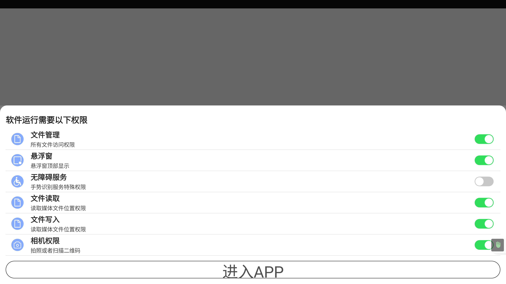

<div align="center">

# rk3588-air-gesture

**RK3588 NPU Air-Gesture Control · Android AAR Library + Demo**

Real-time camera gesture recognition on the RK3588 6-TOPS NPU:
🖐 4-direction swipe · 👋 wave · ✊ confirm · ✌️ back

中文 | [English](README_en.md)

`Non-commercial license · Free for personal use`

</div>

---

## ✨ Features

- **Real-time NPU inference**: MediaPipe-style hand models (palm detection + 21
  landmarks) converted to RKNN fp16 — 30~40 ms per frame, live skeleton overlay
- **Focused gesture set**: ✋ open palm swipe = up/down/left/right ·
  👋 wave arm · ✊ fist = confirm · ✌️ victory = back
- **Swipe / wave auto separation**: one big displacement then stop = directional
  swipe; repeated side-to-side oscillation = wave — no false triggers between them
- **Packaged as an AAR**: five API groups (recognition overlay / start-stop /
  real-time callbacks / action mapping / algorithm-frame input) — integrate with a few lines
- **Algorithm-frame input**: works without a camera — feed a `Bitmap` image or
  external YUV frames straight into the NPU; results come back through a callback
  (gesture / confidence / 21 landmarks / palm box / latency), and continuous-frame
  mode reuses the full temporal state machine
- **Configurable**: every gesture can be remapped or set to
  "recognize only, no action"; global action gap prevents false triggers
- **root-powered**: key injection (confirm / back), auto permission grant
- **Permission guide**: on first launch, checks file access / overlay /
  accessibility / camera, with one-tap jumps to each grant screen

## 🆕 What's New in v1.3.0

- **Algorithm-frame input**: feed a `Bitmap` image or external YUV frames straight
  into the NPU; results come back through a callback (gesture / score / 21
  landmarks / palm box / latency)
- **Permission guide**: a new `StartActivity` collects file access, overlay,
  accessibility and camera permissions up front, then **Enter app**
- **Permission library**: accessibility can be opened proactively
- **Fix**: RGB buffer overrun when switching between algorithm frames and camera
  (same size but empty buffer)
- **Release**: [v1.3.0](https://github.com/295173098/rk3588-air-gesture/releases/tag/v1.3.0)
  (APK + AAR)

## 📖 Illustrated Tutorial

### Step 1 · Install & Grant

Download `app-debug.apk` from [Releases](https://github.com/295173098/rk3588-air-gesture/releases):

```bash
adb install -r app-debug.apk
```

On first launch a **permission guide** appears: grant file access / overlay /
accessibility / camera, then tap **Enter app**:



> The accessibility service must be enabled, otherwise global injected actions
> (back / swipe / confirm) will not work.

### Step 2 · Start Recognition

Tap **Start recognition** — the foreground service starts, the NPU pipeline
runs (`GestureNPU: init OK` in logcat), and the live preview with skeleton
appears at the bottom.

### Step 3 · Recognition Overlay (optional)

Tap **Show overlay** — a floating window appears at the top-right corner
with live preview + gesture badge + confidence, on top of **any** app:


### Step 4 · Gesture in Front of the Camera

Stay 40~60 cm from the lens, palm facing the camera. Default gestures:

| Gesture | Action | Notes |
|---------|--------|-------|
| ✋ open palm, swipe up | swipe up | displacement threshold + stop confirmation |
| ✋ open palm, swipe down | swipe down | scrolling, video apps |
| ✋ open palm, swipe left | swipe left | page turning |
| ✋ open palm, swipe right | swipe right | |
| 👋 side-to-side wave | wave event | callback only by default; remappable via `setAction` |
| ✊ fist | confirm | focused OK key (requires root) |
| ✌️ victory | back | accessibility globalBack / root fallback |

> Swipe and wave never interfere: continuous oscillation is never mistaken for
> a directional swipe. Mappings are toggleable per gesture in the app
> (off = recognize only), and fully remappable via `setAction` / `setActionHandler`.

### Step 5 · Integrate as a Library (optional)

Grab `gesturelib-1.3.0-release.aar` from
[Releases](https://github.com/295173098/rk3588-air-gesture/releases):

```kotlin
dependencies { implementation(files("libs/gesturelib-release.aar")) }

GestureEngine.init(context)
GestureEngine.startRecognition()
GestureEngine.showOverlay(true)
GestureEngine.setOnGestureListener(object : GestureListener { /* realtime */ })
GestureEngine.setAction(GestureId.WAVE, null)          // recognize only
GestureEngine.setAction(GestureId.FIST, GestureAction.BACK)  // remap
```

Full API: see the [integration guide](gesturelib/README_API.md) or the demo
source in `app/`.

### Step 6 · Algorithm-Frame Input (image / external frame → NPU → callback)

Beyond the camera, external frames can be fed into the same NPU pipeline. The demo
adds an **Algorithm-frame input** card: pick an image and see the result.

```kotlin
GestureEngine.init(context)

// one-shot: image → NPU → callback (async, callback on a background thread)
GestureEngine.analyzeImage(bitmap) { r ->
    if (r != null && r.hasHand) {
        Log.i("Demo", "${r.gestureName} score=${r.score} ${r.inferenceMs}ms")
        val landmarks = r.landmarks      // 21×3, normalized image coords
    }
}

// blocking variant (do not call on the main thread)
val result: FrameDetection? = GestureEngine.analyzeImage(bitmap)

// continuous external frames (video stream / other camera / pre-processed frames)
GestureEngine.startFrameInput()
GestureEngine.pushFrame(bitmap)      // call per frame; dropped when busy
GestureEngine.pushYuvFrame(y, u, v, width, height,
    yStride, uStride, vStride, uPixelStride, vPixelStride)
GestureEngine.stopFrameInput()
```

`FrameDetection` fields:

| Field | Meaning |
|-------|---------|
| `hasHand` | whether a hand was detected in this frame |
| `gesture` / `gestureName` | static gesture id / name |
| `score` | landmark confidence 0..1 |
| `openFingers` | extended fingers 0..5 |
| `palmX/Y/W/H` | palm box (normalized) |
| `landmarks` | 21×3 landmarks (x,y,z normalized) |
| `inferenceMs` | NPU latency for this frame |

> Continuous-frame mode reuses the full temporal state machine: `onFrame` /
> `onGestureTriggered` still fire and action mapping still applies — only the frame
> source changes. Frame-input mode never opens the camera and needs no camera
> permission; calling `startRecognition()` exits it automatically.
> Any input size works (letterboxed internally); coordinates are normalized to the
> input frame size.

## 🔨 Build from Source

```bash
git clone https://github.com/295173098/rk3588-air-gesture.git
cd rk3588-air-gesture
./gradlew :app:assembleDebug          # demo APK
./gradlew :gesturelib:assembleRelease # library AAR
```

Requires: JDK 17 · Android SDK 34 · NDK 26.3 · CMake 3.22.1
(model conversion scripts in `tools/model_convert/`)

## 🧠 How It Works

```
Camera YUV420_888 / Bitmap image / external YUV frame → JNI: →RGB → letterbox 192
  → palm_detection.rknn (NPU) → 2016-anchor decode + NMS
  → rotated ROI → hand_landmark.rknn (NPU 224×224) → 21 landmarks
  → geometric static-pose classification (palm / fist / victory) + palm trajectory
  → temporal state machine (confirm frames / cooldown / stop-confirm / reversal count)
      ├─ directional swipe: displacement threshold + stop confirm, dominant axis
      │    → accessibility-injected 4-direction screen swipe
      ├─ wave: X-axis oscillation (≥2 reversals) → event callback
      ├─ fist confirm: root input keyevent 23 (DPAD_CENTER)
      └─ victory back: accessibility globalBack / root keyevent 4
```

Camera frames and algorithm frames share one RGB inference core (serialized in
JNI); single-image analysis resets the tracking ROI and forces palm detection.

Decode math strictly follows the official MediaPipe sources
(SSD anchors / box decode / rect transformation).

## 📄 License

Licensed under the [Non-Commercial Use License](LICENSE):
**free for personal, non-commercial use**; any commercial use requires prior
written permission from the author.

## 🙏 Credits

[MediaPipe Hands](https://github.com/google-ai-edge/mediapipe) ·
[airockchip rknn-toolkit2](https://github.com/airockchip/rknn-toolkit2) ·
[PINTO0309 相关研究](https://github.com/PINTO0309)
